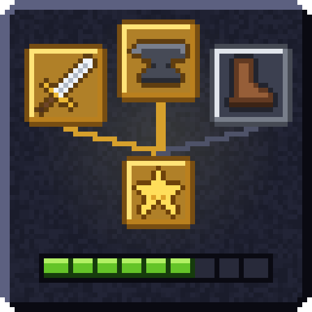
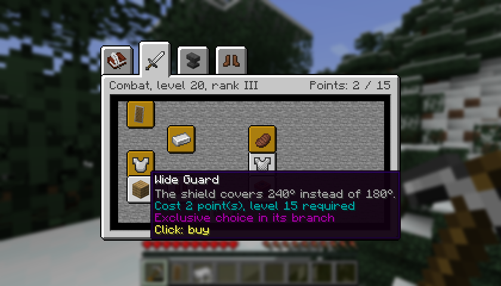

# Legacy Skills

## English

Legacy Skills is a Minecraft mod that gives your character a progression of its own, separate from vanilla experience. Playing earns XP in three disciplines: Combat, Crafting and Adventure. Levels give points to spend in three skill trees, with a specialization and an active skill on top. No node gives extra damage, health, armor, attack speed or luck.

- [The guide](en/guide.md): installing, the two keys, buying nodes, specializations, active skills, respec, playing with others
- [Earning XP](en/xp.md): every XP source, the inactivity filter, diminishing returns, the hourly budget, levels and points
- [Skill trees](en/trees.md): the 24 nodes, the 4 specializations and the exclusive choices
- [Server and datapacks](en/server.md): configuration, commands, saves, datapack format and the API for other mods

This wiki describes version 0.1.0-alpha.3.3, an alpha, so rules and numbers can still change. The XP values are design estimates that haven't been measured on real games yet. The numbers come from the mod's code and data and are its default values: a server can change them.

## Français

Legacy Skills est un mod Minecraft qui donne à votre personnage une progression à lui, indépendante de l'expérience vanilla. Jouer rapporte de l'XP dans trois disciplines : Combat, Artisanat et Aventure. Les niveaux donnent des points à dépenser dans trois arbres de compétences, avec une spécialisation et une compétence active en plus. Aucun nœud ne donne de dégâts, de vie, d'armure, de vitesse d'attaque ou de chance en plus.

- [Le guide](fr/guide.md) : installer, les deux touches, acheter des nœuds, spécialisations, compétences actives, réorientation, jouer à plusieurs
- [Gagner de l'XP](fr/xp.md) : chaque source d'XP, le filtre d'inactivité, le rendement décroissant, le budget horaire, les niveaux et les points
- [Arbres de compétences](fr/arbres.md) : les 24 nœuds, les 4 spécialisations et les choix exclusifs
- [Serveur et datapacks](fr/serveur.md) : configuration, commandes, sauvegardes, format des datapacks et API pour les autres mods

Ce wiki décrit la version 0.1.0-alpha.3.3, en alpha : les règles et les chiffres peuvent encore changer. Les valeurs d'XP sont des estimations de conception, pas encore mesurées sur de vraies parties. Les chiffres viennent du code et des données du mod et sont ses valeurs par défaut : un serveur peut les changer.

