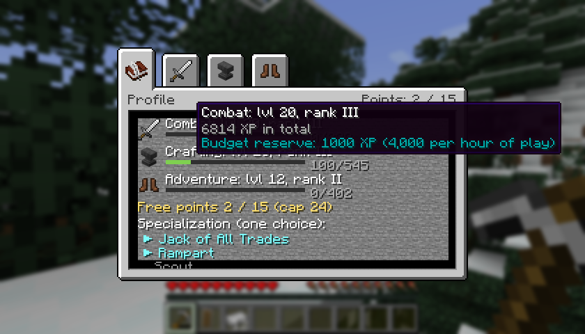
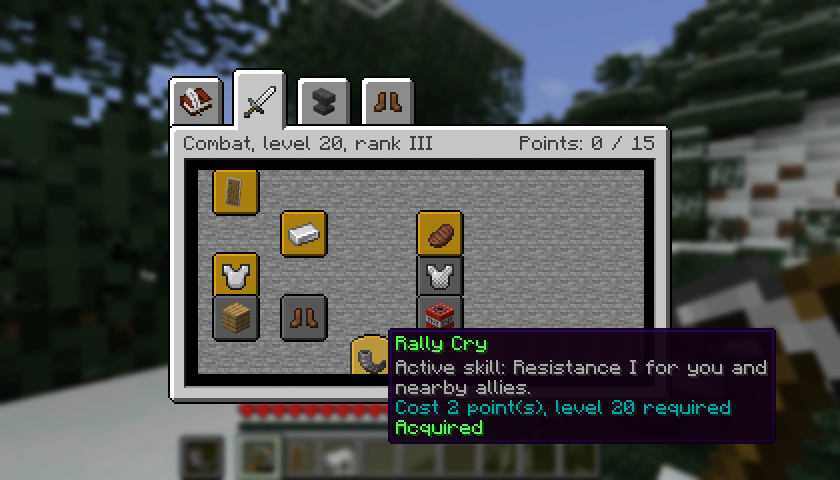
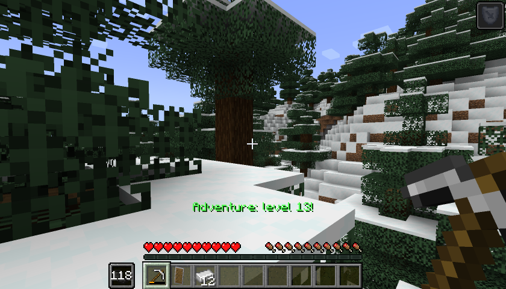

# The guide

[Home](../README.md) · [Earning XP](xp.md) · [Skill trees](trees.md) · [Server and datapacks](server.md) · [Français](../fr/guide.md)

## Installing the mod

You need Minecraft 1.21.1, NeoForge 21.1.265 or newer, and Java 21. Put the same jar in the `mods` folder of the client **and** the server: the mod is needed on both sides. No other mod is needed.

The mod is an alpha, so back up your world before trying it.

## The two keys

| Key | What it does |
|---|---|
| **U** | Opens the skills screen: the Profile tab, then one tab per discipline |
| **H** | Uses the equipped active skill |

Both keys can be changed in Options, Controls, in the Legacy Skills category.

## How it works, in short

1. You play normally. What you do earns XP in three disciplines: **Combat**, **Crafting** and **Adventure**. This XP has nothing to do with vanilla experience: enchanting and the anvil still use vanilla levels.
2. Each discipline goes up to level 50. The XP needed grows with each level. The details are on the [Earning XP](xp.md) page.
3. The sum of your levels in all disciplines gives you **points**, up to 24.
4. You spend these points in the three **skill trees**. Each node needs a level in its own discipline and costs 1 or 2 points.
5. The trees hold 35 points, so you can't take everything. Two branches also make you pick between two nodes.

## Buying a node

Open the screen with U and click a discipline tab. Hover a node to see what it does, its cost and the level it needs. A node with a yellow "Click: buy" line can be bought with a click. The server checks every purchase.

| What you see | What it means |
|---|---|
| Golden frame | Acquired |
| Light frame | Available: click to buy |
| Darkened | Locked: level, points or prerequisites missing, the tooltip says what |
| Reddened | Excluded by the other node of an exclusive choice |
| Brownish | Pending: refunded because it no longer fits, it comes back by itself when it fits again |

Active skills have a rounded frame.

## Specialization

You have a single specialization slot. You choose it in the Profile tab, once you meet its conditions. There are four:

| Specialization | Conditions | Effect |
|---|---|---|
| Rampart | Combat 20 and Bracing | No knockback on a hit blocked with a shield; Rally Cry recharges in 60 s instead of 120 s |
| Workshop Master | Crafting 20, Steady Hand and Thrifty Repair | The anvil never breaks; the anvil penalty is halved after a real repair |
| Scout | Adventure 20 | Safe fall +3 blocks; Dash recharges in 6 s instead of 12 s |
| Jack of All Trades | Level 10 in all three disciplines | +3 points, above the cap of 24 |

If you later lose a condition, for example after a respec, the specialization stays chosen but stops working until you meet it again.

## Active skills

Three nodes unlock an active skill: Rally Cry (Combat), Field Repair (Crafting) and Dash (Adventure). You equip one in the Profile tab and use it with **H**. Changing the equipped skill takes 10 seconds before it can be used.

| Active skill | Effect | Cooldown |
|---|---|---|
| Rally Cry | Resistance I for 6 s, for you and players within 8 blocks | 120 s (60 s with Rampart) |
| Field Repair | One repair material from your inventory restores 15% of the max durability of the item in your hand | 90 s |
| Dash | A push toward where you look, with no invulnerability | 12 s (6 s as Scout) |

The skill slot next to the hotbar shows the remaining seconds. Cooldowns keep running through death, logging out and respecs. The cooldown only starts if the skill really worked: Field Repair with nothing to repair costs nothing.

## Respec

The Profile tab has a respec line. It refunds all your points and frees your specialization.

- The first respec is free.
- After that, it costs 5 vanilla levels plus 1 per node you own, 30 levels at most.
- You need 2 hours of play between two respecs.

Click once, then click again to confirm.

## Playing with others

Each player has their own profile, saved with the world. When several players hit the same creature, its XP is shared by the damage each one dealt, and a creature is never worth more than its own value. Rally Cry also protects the players around you.

## Why am I not getting XP?

- You're in creative or spectator mode: no XP there.
- You haven't touched anything for 2 minutes (half XP) or 5 minutes (no XP). Look around, move or open your inventory. See [the inactivity filter](xp.md#inactivity).
- You've been repeating the same thing: it pays less and less, then recovers over time. See [diminishing returns](xp.md#diminishing-returns).
- You've used up your hourly budget for that discipline. See [the hourly budget](xp.md#the-hourly-budget).
- The creature came from a monster spawner: it's worth a tenth.
- The server owner changed the settings.
