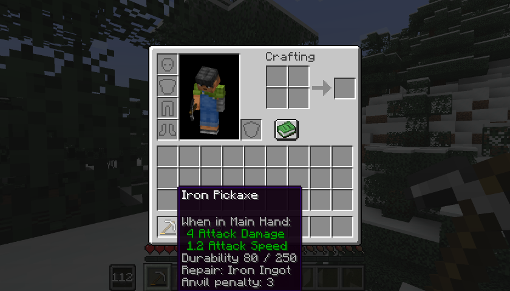

# Skill trees

[Home](../README.md) · [Guide](guide.md) · [Earning XP](xp.md) · [Server and datapacks](server.md) · [Français](../fr/arbres.md)

24 nodes in three trees, 35 points in all. Levels give 24 points at most (27 with Jack of All Trades), so you have to choose. No node needs another node first: only the level in its discipline and the points count. No node gives extra damage, health, armor, attack speed or luck.

## Combat

9 nodes, 15 points in the tree, 13 usable because of the guard choice.

| Node | Level | Cost | Effect |
|---|---|---|---|
| Quick Guard | 3 | 1 | The shield blocks as soon as it's raised, without the 5-tick delay |
| Shield Care | 5 | 1 | Shield wear -50% |
| Second Wind | 5 | 1 | A kill where you dealt at least 25% of the damage gives back 1 hunger point, once every 30 s |
| Bracing | 10 | 2 | Knockback -50% on a hit blocked with a shield |
| Armor Care | 10 | 2 | Armor wear -25% |
| Wide Guard | 15 | 2 | The shield covers 240° instead of 180°. **Exclusive** with Mobile Guard |
| Mobile Guard | 15 | 2 | You walk at 50% speed instead of 20% while guarding. **Exclusive** with Wide Guard |
| Composure | 15 | 2 | Explosion knockback -50% |
| Rally Cry | 20 | 2 | Active skill: Resistance I for 6 s, for you and players within 8 blocks. Cooldown 120 s |

## Crafting

6 nodes, 9 points.

| Node | Level | Cost | Effect |
|---|---|---|---|
| Material Insight | 3 | 1 | Item tooltips show the exact durability, the repair material and the anvil penalty |
| Wear Alert | 5 | 1 | A message when the item in your hand drops below 5% durability |
| Steady Hand | 5 | 1 | Anvil break chance -50% |
| Thrifty Repair | 10 | 2 | After a real repair, the anvil penalty doesn't go up |
| Salvage | 15 | 2 | 15% chance to get one ingredient back when crafting a durable item |
| Field Repair | 20 | 2 | Active skill: one material from your inventory restores 15% durability to the item in your hand. Cooldown 90 s |

Salvage only gives back basic ingredients from the `legacyskills:recoverable` tag (iron, gold and copper ingots, diamonds, leather, string, flint, feathers, sticks, rabbit hide, scutes, breeze rods), never an item with modified components. Thrifty Repair and Workshop Master only act on the vanilla anvil.

## Adventure

9 nodes, 15 points in the tree, 13 usable because of the stride choice.

| Node | Level | Cost | Effect |
|---|---|---|---|
| Soft Landing | 3 | 1 | Safe fall distance +2 blocks |
| Long Breath | 5 | 1 | Oxygen bonus +1: about twice as long under water |
| Swimmer | 5 | 1 | Swimming speed +20% |
| Light Step | 10 | 2 | Step height +0.4: you step up a full block without jumping |
| Frugal | 10 | 2 | Food gives 20% more saturation |
| Rough Terrain | 15 | 2 | Movement efficiency +0.5: less slowed by soul sand, mud and the like |
| Tanned Skin | 15 | 2 | Burning time -50% |
| Dash | 20 | 2 | Active skill: a push toward where you look, with no invulnerability. Cooldown 12 s. **Exclusive** with Pace |
| Pace | 20 | 2 | Walking speed +5%. **Exclusive** with Dash |

## Specializations

One slot. The conditions are checked all the time: a specialization whose conditions are no longer met stays chosen but stops working.

| Specialization | Conditions | Effect |
|---|---|---|
| Rampart | Combat 20 and Bracing | No knockback at all on a hit blocked with a shield; Rally Cry recharges in 60 s |
| Workshop Master | Crafting 20, Steady Hand and Thrifty Repair | The anvil never breaks; the anvil penalty is halved after a real repair |
| Scout | Adventure 20 | Safe fall distance +3 blocks; Dash recharges in 6 s |
| Jack of All Trades | Level 10 in Combat, Crafting and Adventure | +3 points above the cap |

## Exclusive choices

| Group | Nodes |
|---|---|
| Guard style (Combat) | Wide Guard or Mobile Guard |
| Stride (Adventure) | Dash or Pace |

To switch to the other node of a pair, you have to respec.

## Compatibility notes

- Only a real shield counts for the shield nodes and the shield XP. A weapon guard from another mod doesn't.
- Effects that change attributes use temporary modifiers named `legacyskills:effect/...`. They are put back on login, respawn, dimension change and `/reload`, and never stack.
