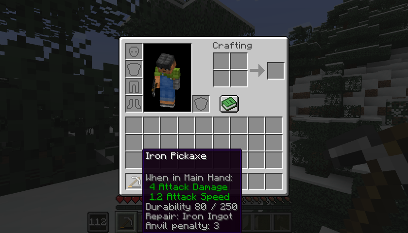

# Arbres de compétences

[Accueil](../README.md) · [Guide](guide.md) · [Gagner de l'XP](xp.md) · [Serveur et datapacks](serveur.md) · [English](../en/trees.md)

24 nœuds dans trois arbres, 35 points en tout. Les niveaux donnent 24 points au plus (27 avec Touche-à-tout) : il faut choisir. Aucun nœud ne demande un autre nœud avant lui : seuls le niveau dans sa discipline et les points comptent. Aucun nœud ne donne de dégâts, de vie, d'armure, de vitesse d'attaque ou de chance en plus.

## Combat

9 nœuds, 15 points dans l'arbre, 13 utilisables à cause du choix de garde.

| Nœud | Niveau | Coût | Effet |
|---|---|---|---|
| Garde vive | 3 | 1 | Le bouclier bloque dès qu'il est levé, sans le délai de 5 ticks |
| Bouclier ménagé | 5 | 1 | Usure du bouclier -50 % |
| Second souffle | 5 | 1 | Une mise à mort où vous avez fait au moins 25 % des dégâts rend 1 point de faim, une fois toutes les 30 s |
| Encaissement | 10 | 2 | Recul -50 % sur un coup bloqué au bouclier |
| Armure entretenue | 10 | 2 | Usure de l'armure -25 % |
| Garde large | 15 | 2 | Le bouclier couvre 240° au lieu de 180°. **Exclusif** avec Garde mobile |
| Garde mobile | 15 | 2 | Vous marchez à 50 % de votre vitesse au lieu de 20 % en garde. **Exclusif** avec Garde large |
| Sang-froid | 15 | 2 | Recul des explosions -50 % |
| Cri de ralliement | 20 | 2 | Compétence active : Résistance I pendant 6 s, pour vous et les joueurs à moins de 8 blocs. Recharge 120 s |

## Artisanat

6 nœuds, 9 points.

| Nœud | Niveau | Coût | Effet |
|---|---|---|---|
| Jugement des matières | 3 | 1 | Les info-bulles des objets montrent la durabilité exacte, le matériau de réparation et la pénalité d'enclume |
| Alerte d'usure | 5 | 1 | Un message quand l'objet en main passe sous 5 % de durabilité |
| Main sûre | 5 | 1 | Chance de casse de l'enclume -50 % |
| Réparation économe | 10 | 2 | Après une vraie réparation, la pénalité d'enclume n'augmente pas |
| Chute récupérée | 15 | 2 | 15 % de chance de récupérer un ingrédient en fabriquant un objet durable |
| Réparation de fortune | 20 | 2 | Compétence active : un matériau de votre inventaire rend 15 % de durabilité à l'objet en main. Recharge 90 s |

Chute récupérée ne rend que des ingrédients de base du tag `legacyskills:recoverable` (lingots de fer, d'or et de cuivre, diamants, cuir, ficelle, silex, plumes, bâtons, peau de lapin, écailles, bâtons de Breeze), jamais un objet aux composants modifiés. Réparation économe et Maître d'atelier n'agissent que sur l'enclume vanilla.

## Aventure

9 nœuds, 15 points dans l'arbre, 13 utilisables à cause du choix d'allure.

| Nœud | Niveau | Coût | Effet |
|---|---|---|---|
| Chute amortie | 3 | 1 | Distance de chute sans dégâts +2 blocs |
| Souffle long | 5 | 1 | Bonus d'oxygène +1 : environ deux fois plus longtemps sous l'eau |
| Nageur | 5 | 1 | Vitesse de nage +20 % |
| Pied léger | 10 | 2 | Hauteur de pas +0,4 : vous montez un bloc entier sans sauter |
| Frugal | 10 | 2 | La nourriture donne 20 % de saturation en plus |
| Terrain difficile | 15 | 2 | Efficacité de déplacement +0,5 : moins ralenti par le sable des âmes, la boue, etc. |
| Peau tannée | 15 | 2 | Durée de combustion -50 % |
| Élan | 20 | 2 | Compétence active : une poussée vers où vous regardez, sans invulnérabilité. Recharge 12 s. **Exclusif** avec Allure |
| Allure | 20 | 2 | Vitesse de marche +5 %. **Exclusif** avec Élan |

## Spécialisations

Un seul emplacement. Les conditions sont vérifiées en permanence : une spécialisation dont les conditions ne sont plus remplies reste choisie mais ne fait plus rien.

| Spécialisation | Conditions | Effet |
|---|---|---|
| Rempart | Combat 20 et Encaissement | Plus aucun recul sur un coup bloqué au bouclier ; le Cri de ralliement se recharge en 60 s |
| Maître d'atelier | Artisanat 20, Main sûre et Réparation économe | L'enclume ne casse jamais ; la pénalité d'enclume est divisée par deux après une vraie réparation |
| Éclaireur | Aventure 20 | Distance de chute sans dégâts +3 blocs ; l'Élan se recharge en 6 s |
| Touche-à-tout | Niveau 10 en Combat, Artisanat et Aventure | +3 points au-dessus du plafond |

## Choix exclusifs

| Groupe | Nœuds |
|---|---|
| Style de garde (Combat) | Garde large ou Garde mobile |
| Allure (Aventure) | Élan ou Allure |

Pour passer à l'autre nœud d'une paire, il faut une réorientation.

## Notes de compatibilité

- Seul un vrai bouclier compte pour les nœuds de bouclier et l'XP de bouclier. Une garde à l'arme d'un autre mod ne compte pas.
- Les effets qui changent des attributs passent par des modificateurs temporaires nommés `legacyskills:effect/...`. Ils sont remis à la connexion, à la réapparition, au changement de dimension et au `/reload`, et ne se cumulent jamais.
