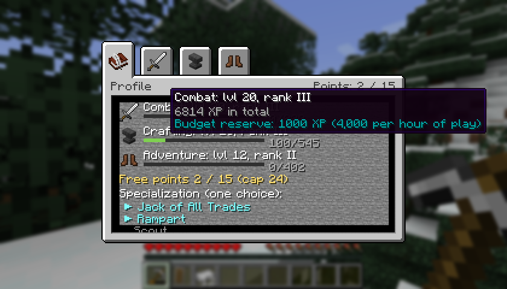
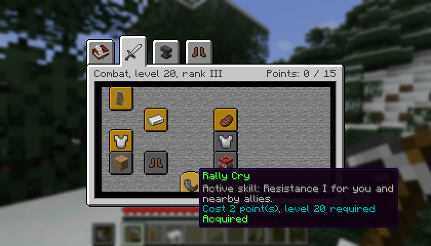
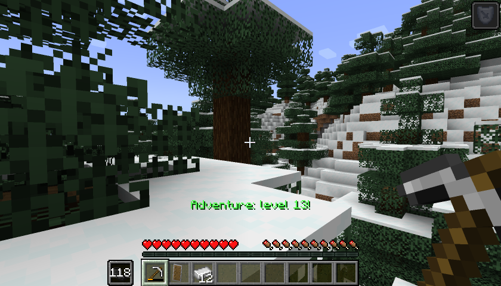

# Le guide

[Accueil](../README.md) · [Gagner de l'XP](xp.md) · [Arbres de compétences](arbres.md) · [Serveur et datapacks](serveur.md) · [English](../en/guide.md)

## Installer le mod

Il faut Minecraft 1.21.1, NeoForge 21.1.265 ou plus récent, et Java 21. Mettez le même jar dans le dossier `mods` du client **et** du serveur : le mod est requis des deux côtés. Aucun autre mod n'est nécessaire.

Le mod est en alpha : sauvegardez votre monde avant d'essayer.

## Les deux touches

| Touche | Ce qu'elle fait |
|---|---|
| **U** | Ouvre l'écran des compétences : l'onglet Profil, puis un onglet par discipline |
| **H** | Utilise la compétence active équipée |

Les deux touches se changent dans Options, Commandes, catégorie Legacy Skills.

## Comment ça marche, en bref

1. Vous jouez normalement. Ce que vous faites rapporte de l'XP dans trois disciplines : **Combat**, **Artisanat** et **Aventure**. Cette XP n'a rien à voir avec l'expérience vanilla : l'enchantement et l'enclume utilisent toujours les niveaux vanilla.
2. Chaque discipline monte jusqu'au niveau 50. L'XP demandée augmente à chaque niveau. Le détail est sur la page [Gagner de l'XP](xp.md).
3. La somme de vos niveaux dans toutes les disciplines vous donne des **points**, 24 au plus.
4. Vous dépensez ces points dans les trois **arbres de compétences**. Chaque nœud demande un niveau dans sa propre discipline et coûte 1 ou 2 points.
5. Les arbres contiennent 35 points : vous ne pouvez pas tout prendre. Deux branches vous font aussi choisir entre deux nœuds.

## Acheter un nœud

Ouvrez l'écran avec U et cliquez sur l'onglet d'une discipline. Passez la souris sur un nœud pour voir ce qu'il fait, son coût et le niveau demandé. Un nœud avec une ligne jaune « Clic : acheter » s'achète d'un clic. Le serveur vérifie chaque achat.

| Ce que vous voyez | Ce que ça veut dire |
|---|---|
| Cadre doré | Acquis |
| Cadre clair | Disponible : cliquer pour acheter |
| Assombri | Verrouillé : niveau, points ou prérequis manquants, l'info-bulle dit lequel |
| Rougi | Exclu par l'autre nœud d'un choix exclusif |
| Brunâtre | En attente : rendu parce qu'il ne tient plus, il revient tout seul quand il tient de nouveau |

Les compétences actives ont un cadre arrondi.

## Spécialisation

Vous avez un seul emplacement de spécialisation. Vous la choisissez dans l'onglet Profil, une fois ses conditions remplies. Il y en a quatre :

| Spécialisation | Conditions | Effet |
|---|---|---|
| Rempart | Combat 20 et Encaissement | Aucun recul sur un coup bloqué au bouclier ; le Cri de ralliement se recharge en 60 s au lieu de 120 s |
| Maître d'atelier | Artisanat 20, Main sûre et Réparation économe | L'enclume ne casse jamais ; la pénalité d'enclume est divisée par deux après une vraie réparation |
| Éclaireur | Aventure 20 | Chute sans dégâts +3 blocs ; l'Élan se recharge en 6 s au lieu de 12 s |
| Touche-à-tout | Niveau 10 dans les trois disciplines | +3 points, au-dessus du plafond de 24 |

Si vous perdez ensuite une condition, par exemple après une réorientation, la spécialisation reste choisie mais ne fait plus rien jusqu'à ce que vous la remplissiez de nouveau.

## Compétences actives

Trois nœuds débloquent une compétence active : Cri de ralliement (Combat), Réparation de fortune (Artisanat) et Élan (Aventure). Vous en équipez une dans l'onglet Profil et l'utilisez avec **H**. Après un changement, il faut attendre 10 secondes avant de pouvoir l'utiliser.

| Compétence active | Effet | Recharge |
|---|---|---|
| Cri de ralliement | Résistance I pendant 6 s, pour vous et les joueurs à moins de 8 blocs | 120 s (60 s avec Rempart) |
| Réparation de fortune | Un matériau de réparation de votre inventaire rend 15 % de la durabilité maximale de l'objet en main | 90 s |
| Élan | Une poussée vers où vous regardez, sans invulnérabilité | 12 s (6 s en Éclaireur) |

L'emplacement de la compétence, à côté de la barre d'objets, affiche les secondes restantes. Les recharges continuent malgré la mort, la déconnexion et la réorientation. La recharge ne démarre que si la compétence a vraiment agi : une Réparation de fortune sans rien à réparer ne coûte rien.

## Réorientation

L'onglet Profil a une ligne de réorientation. Elle rend tous vos points et libère votre spécialisation.

- La première réorientation est gratuite.
- Ensuite, elle coûte 5 niveaux vanilla plus 1 par nœud possédé, 30 niveaux au plus.
- Il faut 2 heures de jeu entre deux réorientations.

Cliquez une fois, puis encore une fois pour confirmer.

## Jouer à plusieurs

Chaque joueur a son propre profil, sauvegardé avec le monde. Quand plusieurs joueurs frappent la même créature, son XP est partagée selon les dégâts de chacun, et une créature ne vaut jamais plus que sa propre valeur. Le Cri de ralliement protège aussi les joueurs autour de vous.

## Pourquoi je ne gagne pas d'XP ?

- Vous êtes en créatif ou en spectateur : aucune XP.
- Vous n'avez touché à rien depuis 2 minutes (XP divisée par deux) ou 5 minutes (aucune XP). Regardez autour de vous, bougez ou ouvrez votre inventaire. Voir [le filtre d'inactivité](xp.md#inactivité).
- Vous répétez la même chose : ça rapporte de moins en moins, puis ça revient avec le temps. Voir [le rendement décroissant](xp.md#rendement-décroissant).
- Vous avez épuisé le budget horaire de cette discipline. Voir [le budget horaire](xp.md#le-budget-horaire).
- La créature sortait d'un générateur de monstres : elle vaut dix fois moins.
- L'administrateur du serveur a changé les réglages.
